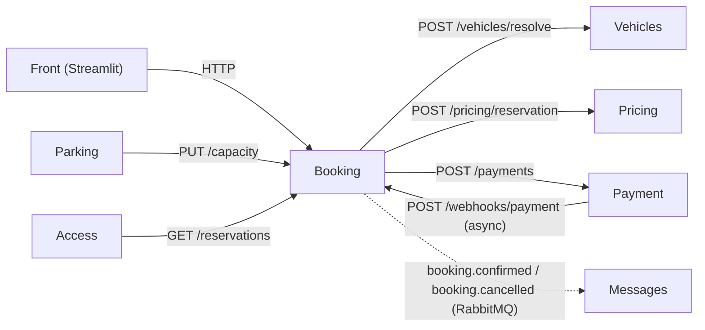
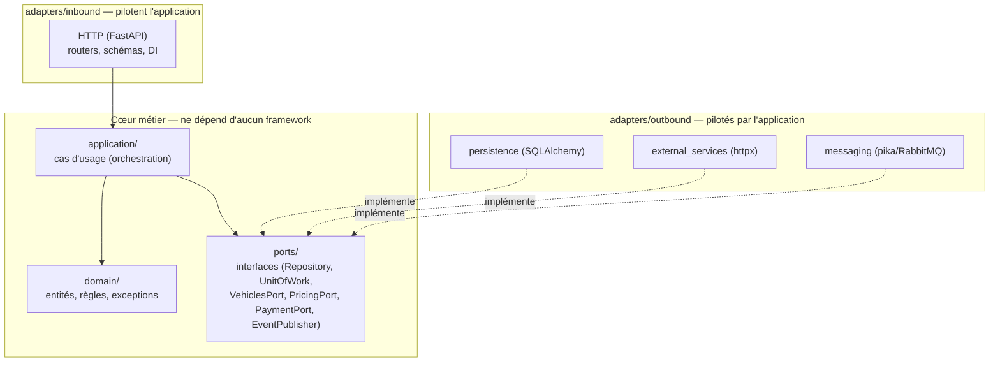
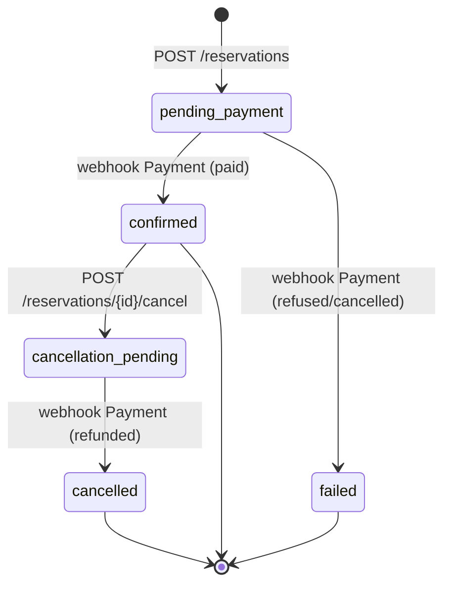
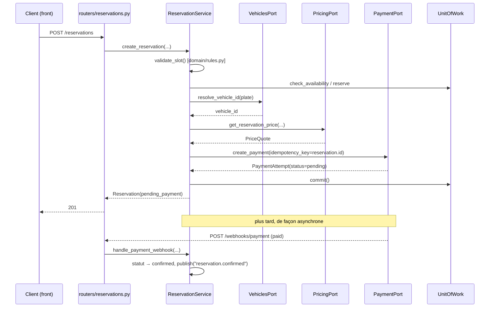
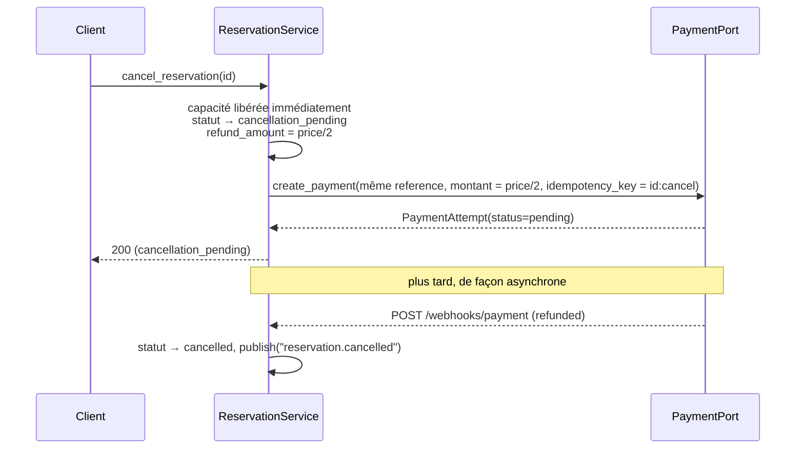

# Architecture — service Booking

Documentation technique du service **Booking** (voir le cadrage métier dans
[`projet_fil_rouge_parking_cadrage_metier.md`](./projet_fil_rouge_parking_cadrage_metier.md)
pour le contexte global du projet, et
[`booking_test_scenario.md`](./booking_test_scenario.md) pour un scénario de
test bout-en-bout).

## 1. Rôle du service

Booking gère la disponibilité future du parking (un calendrier de capacité
par type de place et par heure) et le cycle de vie d'une réservation :
recherche de créneau → tarification → paiement anticipé → confirmation →
annulation avec remboursement partiel.

**Ce que Booking possède** : les réservations, le calendrier de capacité qui
lui est allouée.
**Ce que Booking ne possède pas** : les plaques réelles (Vehicles), les
règles de tarification (Pricing), la logique de paiement (Payment),
l'attribution physique d'une place précise (Parking/Access).

### Place dans le système



Vehicles, Pricing, Payment sont appelés en **HTTP synchrone** (Booking a
besoin de leur réponse pour continuer). Payment répond d'abord un statut
intermédiaire (`pending`) puis rappelle Booking de façon **asynchrone** sur
un webhook une fois le paiement (ou le remboursement) tranché. Messages est
notifié par **événement** sur un bus RabbitMQ (CloudAMQP), sans attendre de
réponse.

---

## 2. Architecture hexagonale (ports & adapters)

Le code de Booking est organisé pour qu'une seule règle soit toujours vraie :
**le métier ne dépend jamais d'une technologie**. `app/domain/` et
`app/application/` ignorent totalement l'existence de FastAPI, SQLAlchemy,
httpx ou pika — ils ne connaissent que des interfaces (`app/ports/`). Ce sont
les adaptateurs (`app/adapters/`) qui branchent une technologie concrète sur
ces interfaces, dans un sens ou dans l'autre :



- **`domain/`** : objets et règles métier purs (dataclasses Python, aucune
  ligne ne sait qu'une base de données existe). C'est le centre de
  l'hexagone.
- **`ports/`** : les interfaces (`ABC`) dont `application/` a besoin pour
  travailler — persistance, services externes, publication d'événements.
  Un port ne sait rien de son implémentation.
- **`application/`** : les cas d'usage (ex-`services/`) — `ReservationService`,
  `CapacityService`. Ils orchestrent le domaine à travers les ports
  uniquement. C'est ici que vit la logique métier de Booking.
- **`adapters/inbound/http/`** : le seul point d'entrée aujourd'hui (une API
  REST FastAPI). Traduit une requête HTTP en appel de cas d'usage, et une
  exception métier en code de statut. Remplaçable par un autre adaptateur
  entrant (CLI, consommateur d'événements...) sans toucher au métier.
- **`adapters/outbound/`** : les implémentations concrètes des ports —
  SQLAlchemy pour la persistance, httpx pour Vehicles/Pricing/Payment, pika
  pour la publication vers Messages/Notification. Remplaçables (autre base,
  autre broker) sans toucher au métier.

**Sens des dépendances** : toutes les flèches de code pointent vers le
centre (`domain/`). Un adaptateur peut importer `ports/` et `domain/` ;
`application/` peut importer `domain/` et `ports/` ; mais `domain/` et
`ports/` n'importent jamais un adaptateur. C'est ce qui permet de changer de
base de données ou de broker sans modifier une seule ligne de logique
métier.

---

## 3. Arborescence du dépôt

```
api/V1/booking/
  app/
    main.py                        # composition root : assemble l'app FastAPI
    config.py                      # configuration (variables d'env)

    domain/                        # cœur métier — zéro dépendance framework
      entities.py                  # Reservation, CapacitySlot (dataclasses)
      enums.py                     # PlaceType, ReservationStatus
      value_objects.py             # PriceQuote, PaymentAttempt
      exceptions.py                # exceptions métier (DomainError et sous-classes)
      rules.py                     # validate_slot, hour_slots (fonctions pures)

    ports/                         # interfaces dont dépend application/
      repositories.py              # ReservationRepository, CapacityRepository
      unit_of_work.py              # UnitOfWork
      external_services.py         # VehiclesPort, PricingPort, PaymentPort
      event_publisher.py           # EventPublisher

    application/                   # cas d'usage (orchestration métier)
      reservation_service.py       # création, annulation, traitement des webhooks
      capacity_service.py          # disponibilité, réservation/libération de capacité

    adapters/
      inbound/
        http/                      # adaptateur entrant : API REST FastAPI
          schemas.py                # DTOs Pydantic (requêtes/réponses)
          dependencies.py            # câblage : construit les cas d'usage avec leurs adaptateurs
          exception_handlers.py       # traduit les exceptions domain/ en codes HTTP
          routers/
            health.py, availability.py, reservations.py, capacity.py, webhooks.py
      outbound/
        persistence/                # implémentation SQLAlchemy des ports de persistance
          database.py                # engine/session
          orm_models.py               # tables SQLAlchemy (séparées des entités du domaine)
          repositories.py              # Sql...Repository : convertit ORM <-> domaine
          unit_of_work.py               # SqlAlchemyUnitOfWork
        external_services/          # implémentation HTTP des ports Vehicles/Pricing/Payment
          vehicles_client.py, pricing_client.py, payment_client.py
        messaging/                  # implémentation du port EventPublisher
          event_publishers.py        # LoggingEventPublisher, RabbitMQEventPublisher

  mocks/
    server.py                      # simule Vehicles/Pricing/Payment en local
  scripts/
    seed_capacity.py                # peuple la capacité réservable pour le dev/test
  requirements.txt, .env(.example), Dockerfile

front/
  app.py                           # interface Streamlit (client final)

docs/
  projet_fil_rouge_parking_cadrage_metier.md   # cadrage métier partagé par l'équipe
  booking_test_scenario.md                     # scénario de test manuel
  booking_architecture.md                      # ce document
```

---

## 4. Modèle de données

Le domaine et la persistance ont chacun leur propre représentation, reliées
par les repositories — c'est le point le plus visible de la séparation
hexagonale.

| | `domain/entities.py` | `adapters/outbound/persistence/orm_models.py` |
|---|---|---|
| Nature | `@dataclass` Python pur | classe SQLAlchemy (`Base`) |
| Connaît | rien d'autre que lui-même | les colonnes, types SQL, contraintes |
| Utilisé par | `application/` (métier) | `adapters/outbound/persistence/repositories.py` uniquement |

Les fonctions `_reservation_to_domain`/`_capacity_to_domain` (dans
`repositories.py`) convertissent une ligne ORM en entité de domaine à la
lecture ; `add`/`update` font l'inverse à l'écriture. Le reste du code
(cas d'usage, routes) ne manipule jamais un objet ORM.

### `Reservation`

| Champ | Type | Notes |
|---|---|---|
| `id` | `str(6)` | Code à 6 chiffres (`ReservationService._generate_reservation_id`), pas un UUID : c'est la référence que le client communique au parking. Unicité vérifiée via `ReservationRepository.exists`. |
| `vehicle_id` | `str` | Identifiant pseudonymisé (résolu via Vehicles), jamais la plaque réelle. |
| `email` | `str` | Email du client, transmis à Messages/Notification à la confirmation. |
| `place_type` | `PlaceType` | `standard`, `xl`, `handicap`, `electrique`, `deux_roues`. |
| `start_at` / `end_at` | `datetime` | Toujours alignés sur une heure pleine (naïfs, UTC). |
| `status` | `ReservationStatus` | Voir cycle de vie ci-dessous. |
| `price_amount` | `Decimal` | Renvoyé par Pricing. |
| `price_reference` | `str` | Référence de la grille tarifaire utilisée (traçabilité). |
| `payment_id` | `str` | Identifiant du paiement initial côté Payment. |
| `refund_amount` | `Decimal` | Renseigné uniquement si la réservation est annulée. |

### `CapacitySlot`

Un compteur par type de place et par heure pleine — **pas d'affectation
nominale** d'une place précise, conformément au cadrage (le parking gère un
stock, pas des places numérotées). `free` (propriété calculée) =
`allocated - booked`.

### Cycle de vie d'une réservation



`pending_payment` et `cancellation_pending` sont les deux seuls états « en
attente d'un webhook » ; tous les autres sont terminaux.
`ReservationService.handle_payment_webhook` est écrit comme un `if` sur
l'état courant : chaque état sait quels statuts de webhook il attend, et
ignore silencieusement les autres (idempotence — un rejeu réseau ou un
callback dupliqué n'a pas d'effet une deuxième fois).

---

## 5. Ports & adapters — le détail

| Port (`app/ports/`) | Rôle | Implémentation (`app/adapters/outbound/`) |
|---|---|---|
| `ReservationRepository` | CRUD sur les réservations | `SqlAlchemyReservationRepository` |
| `CapacityRepository` | lecture/écriture de la capacité | `SqlAlchemyCapacityRepository` |
| `UnitOfWork` | regroupe les deux repos dans une transaction | `SqlAlchemyUnitOfWork` |
| `VehiclesPort` | résoudre une plaque en id pseudonymisé | `HttpVehiclesClient` |
| `PricingPort` | obtenir le prix d'un créneau | `HttpPricingClient` |
| `PaymentPort` | déclencher un paiement | `HttpPaymentClient` |
| `EventPublisher` | publier un événement métier | `LoggingEventPublisher` / `RabbitMQEventPublisher` |

**Unit of Work** : `ReservationService`/`CapacityService` ne committent
jamais au milieu d'une opération à plusieurs étapes (ex. réserver la
capacité + créer la réservation + appeler Payment). C'est l'appelant de plus
haut niveau qui décide quand tout valider (`uow.commit()`) ou tout annuler
(`uow.rollback()`), pour que ces étapes réussissent ou échouent ensemble —
exactement comme une transaction SQL classique, mais exprimée indépendamment
de SQLAlchemy.

**Câblage** (`adapters/inbound/http/dependencies.py`) : à chaque requête,
FastAPI construit un `SqlAlchemyUnitOfWork` (une session par requête, comme
avant), puis assemble un `ReservationService`/`CapacityService` avec les
adaptateurs concrets. C'est le **seul** fichier du projet qui connaît à la
fois un port et son implémentation réelle — remplacer SQLite par Postgres,
ou brancher un vrai service Vehicles, ne touche que ce fichier (et
`config.py` pour l'URL).

**Gestion des erreurs** : le domaine lève des exceptions Python pures
(`app/domain/exceptions.py` : `InvalidSlotError`, `CapacityUnavailableError`,
`ReservationNotFoundError`, `InvalidReservationStateError`,
`ReservationIdGenerationError`, `ExternalServiceError`). Aucune route ne
fait de `try/except` — `adapters/inbound/http/exception_handlers.py`
centralise la traduction en code HTTP :

| Exception | Code |
|---|---|
| `InvalidSlotError` | 422 |
| `CapacityUnavailableError` | 409 |
| `ReservationNotFoundError` | 404 |
| `InvalidReservationStateError` | 409 |
| `ReservationIdGenerationError` | 500 |
| `ExternalServiceError` | 502 |

---

## 6. API — vue d'ensemble

Documentation complète et interactive sur `/docs` (Swagger) une fois l'API
lancée. Résumé :

| Méthode | Route | Rôle | Appelée par |
|---|---|---|---|
| `GET` | `/health` | Supervision | tous |
| `GET` | `/availability` | Dispo sur un créneau (lecture seule) | front, tests |
| `POST` | `/reservations` | Créer une réservation | front (client) |
| `GET` | `/reservations/{id}` | Consulter une réservation | front, client |
| `GET` | `/reservations?vehicle_id=` | Lister les réservations d'un véhicule | **Access** |
| `POST` | `/reservations/{id}/cancel` | Annuler une réservation confirmée (remboursement 50%) | front (client) |
| `PUT` | `/capacity` | Allouer la capacité réservable d'un créneau | **Parking** |
| `POST` | `/webhooks/payment` | Callback asynchrone de statut de paiement/remboursement | **Payment** |

---

## 7. Flux métier détaillés

### 7.1. Création d'une réservation



Points d'implémentation (`ReservationService.create_reservation`) :
- La disponibilité est vérifiée **tôt** (retour rapide au client) avant de
  payer le coût d'un appel réseau à Vehicles, puis **re-vérifiée** juste
  avant de réserver effectivement la capacité, pour couvrir une course entre
  deux requêtes concurrentes sur le même créneau.
- `idempotency_key = reservation.id` envoyé à Payment : un retry de cette
  requête ne doit jamais déclencher un second encaissement.
- Si Pricing ou Payment échoue, la réservation est supprimée et la capacité
  libérée (compensation explicite) plutôt que de laisser une réservation
  bloquée sans paiement associé — l'exception est traduite en
  `ExternalServiceError` (502).

### 7.2. Annulation avec remboursement de 50%



Seules les réservations `confirmed` sont annulables (`InvalidReservationStateError`
→ 409 sinon). La capacité est libérée **immédiatement** à la demande
d'annulation — le parking peut revendre le créneau sans attendre que le
remboursement soit effectivement traité côté Payment.

⚠️ **Hypothèse de contrat à valider avec Payment** : Booking rappelle
`create_payment` avec la **même** `reference` (l'id de réservation) mais un
montant à moitié prix, et suppose que Payment détecte l'écart avec ce qu'il
a déjà encaissé pour cette référence et déclenche un remboursement de la
différence. C'est une convention posée côté Booking pour ce MVP, pas un
contrat déjà négocié avec l'implémentation réelle de Payment — le mock
(`mocks/server.py`) la simule à l'identique pour permettre de développer et
tester en attendant.

### 7.3. Idempotence du webhook

`ReservationService.handle_payment_webhook` corrèle uniquement sur
`reference` (l'id de réservation) — pas sur `payment_id`, qui peut
légitimement différer entre le paiement initial et un remboursement. Le
comportement dépend de l'état courant de la réservation :

- `pending_payment` : attend `paid` (→ `confirmed`) ou `refused`/`cancelled`
  (→ `failed`, capacité libérée) ; `pending` ne fait rien.
- `cancellation_pending` : attend `refunded` (→ `cancelled`) ; tout le reste
  ne fait rien.
- Tout autre état (déjà terminal) : le callback est ignoré — un rejeu réseau
  ou un webhook dupliqué n'a plus d'effet.

---

## 8. Bus d'événements (RabbitMQ / CloudAMQP)

À la confirmation et à l'annulation d'une réservation, Booking publie un
événement consommé par le service **Messages/Notification** :

| Événement interne | Routing key AMQP | Champ `event` du message |
|---|---|---|
| `reservation.confirmed` | `booking.confirmed` | `RESERVATION_CONFIRMED` |
| `reservation.cancelled` | `booking.cancelled` | `RESERVATION_CANCELLED` |

Exchange : `microservice-event-bus` (nom configurable via
`EVENT_BUS_EXCHANGE`). Implémentation dans
`adapters/outbound/messaging/event_publishers.py` :
- `RabbitMQEventPublisher` : utilisée dès que `CLOUDAMQP_URL` est configurée.
  Ouvre une connexion pika, publie, referme (pas de pool de connexions —
  volume d'événements faible pour ce MVP).
- `LoggingEventPublisher` : utilisée sinon (dev sans bus réel) — logge
  l'événement au lieu de le publier.

`adapters/inbound/http/dependencies.py` choisit l'implémentation une seule
fois au démarrage (`build_event_publisher`), selon la config — le reste du
code ne dépend que du port `EventPublisher`.

⚠️ **Tester en local sans toucher au bus partagé** : `CLOUDAMQP_URL` étant
lue depuis `.env`, la façon fiable de désactiver temporairement la
publication réelle est d'éditer directement cette ligne dans `.env` (la
vider, tester, la restaurer) — **positionner `$env:CLOUDAMQP_URL` dans
PowerShell avant de lancer `uvicorn` ne fonctionne pas** : une variable
d'environnement PowerShell assignée à une chaîne vide n'est pas transmise au
process enfant (`os.environ` ne la voit pas), donc `pydantic-settings`
retombe silencieusement sur la valeur de `.env`. Deux événements de test
sont partis sur le bus partagé à cause de ce piège pendant le développement
— sans conséquence réelle (données fictives, email en `@example.com`), mais
à garder en tête.

---

## 9. Configuration

Toutes les valeurs sont dans `app/config.py` (`pydantic-settings`), lues
depuis l'environnement ou un fichier `.env` (voir `.env.example`) :

| Variable | Défaut | Rôle |
|---|---|---|
| `DATABASE_URL` | `sqlite:///./booking.db` | SQLite en dev, Postgres en prod (Render) sans changer le code. |
| `VEHICLES_SERVICE_URL` | mock local (`:9000`) | À remplacer par la vraie URL de Vehicles. |
| `PRICING_SERVICE_URL` | mock local (`:9000`) | Idem pour Pricing. |
| `PAYMENT_SERVICE_URL` | mock local (`:9000`) | Idem pour Payment. |
| `BOOKING_PUBLIC_URL` | `http://localhost:8000` | URL publique de Booking, transmise à Payment pour le webhook. |
| `PAYMENT_WEBHOOK_PATH` | `/webhooks/payment` | |
| `RESERVATION_HORIZON_DAYS` | `30` | Règle métier : horizon de réservation. |
| `RESERVATION_MAX_DURATION_HOURS` | `168` (7j) | Règle métier : durée max, alignée sur le plafond de stationnement. |
| `CLOUDAMQP_URL` | vide | Bus d'événements ; vide = `LoggingEventPublisher` (voir §8). |
| `EVENT_BUS_EXCHANGE` | `microservice-event-bus` | Exchange RabbitMQ partagé avec l'équipe. |

`Settings` (la classe elle-même) est passée telle quelle à `ReservationService`
plutôt que ses champs un par un : c'est de la donnée de configuration, pas
une dépendance infrastructurelle, donc pragmatiquement acceptable même dans
une architecture hexagonale stricte.

---

## 10. Mocks et script de seed

Tant que Vehicles/Pricing/Payment ne sont pas prêts côté équipe,
`mocks/server.py` (un FastAPI séparé, port 9000, **hors de l'hexagone** —
c'est un test double, pas une partie de l'architecture de Booking) simule
les trois :

- `POST /vehicles/resolve` → hash de la plaque.
- `POST /pricing/reservation` → tarif simple par type de place × durée.
- `POST /payment/payments` → répond `pending`, puis confirme (`paid`) après
  3s via le webhook. Détecte aussi le cas remboursement (même `reference`,
  montant différent d'un paiement déjà `paid`) et répond `refunded` après 2s.
- `POST /payment/payments/{id}/force-status` : **outil de test uniquement**,
  déclenche immédiatement le webhook avec le statut demandé (`paid`,
  `refused`, `cancelled`, `refunded`).

La base démarre vide : tant que rien n'a été poussé via `PUT /capacity`, la
capacité vaut `0/0` partout (409 attendu). `scripts/seed_capacity.py` pousse
une capacité par défaut (`standard=10, xl=3, handicap=2, electrique=3,
deux_roues=5`) sur chaque heure des prochains jours, en attendant que le
service Parking existe réellement.

---

## 11. Front (Streamlit)

`front/app.py` est un client minimal : formulaire de réservation (plaque,
email, type de place, créneau — vérifier la dispo, réserver, suivre le
statut jusqu'à `confirmed`/`failed`) et une section séparée pour annuler une
réservation existante à partir de son code à 6 chiffres (suivi jusqu'à
`cancelled`). Il ne fait qu'appeler l'API HTTP de Booking
(`BOOKING_API_URL`) — aucune logique métier côté front, et aucune
connaissance de la structure interne de Booking (il consomme l'API comme le
ferait n'importe quel autre client).

---

## 12. Comment étendre le service (mini cookbook)

| Je veux... | Je touche... |
|---|---|
| Ajouter/modifier une règle métier (ex. horaires, durées) | `domain/rules.py` (et ses appelants dans `application/`) |
| Ajouter un champ à une réservation | `domain/entities.py` + `orm_models.py` + `repositories.py` (mapping) + `schemas.py` (si exposé en HTTP) |
| Ajouter un cas d'usage (ex. prolonger une réservation) | une méthode dans `application/reservation_service.py`, utilisée par une nouvelle route dans `adapters/inbound/http/routers/` |
| Ajouter une route HTTP | `adapters/inbound/http/routers/` + l'enregistrer dans `main.py` |
| Changer de base de données | uniquement `DATABASE_URL` (`config.py`) — `application/` n'y touche pas |
| Remplacer un mock par le vrai service (Vehicles/Pricing/Payment) | uniquement l'URL correspondante dans `.env` — aucun code à changer |
| Ajouter un nouveau service externe à appeler | un port dans `ports/external_services.py` + un adaptateur dans `adapters/outbound/external_services/` + le brancher dans `dependencies.py` |
| Changer de broker d'événements | une nouvelle classe dans `adapters/outbound/messaging/event_publishers.py` implémentant `EventPublisher` |
| Ajouter un point d'entrée non-HTTP (ex. CLI, consommateur d'événements) | un nouveau dossier sous `adapters/inbound/`, qui appelle `application/` comme le fait `adapters/inbound/http/` |
| Tester `application/` sans base de données ni réseau | implémenter des faux adaptateurs (`UnitOfWork`, `VehiclesPort`...) en mémoire — possible précisément parce que `application/` ne dépend que des ports |

---

## 13. Limites connues du MVP

- **Pas de migrations** (pas d'Alembic) : un changement de schéma nécessite
  de supprimer `booking.db` en dev, ou une intervention manuelle (`ALTER
  TABLE`) pour ne pas perdre de données de test.
- **Mocks non persistants** : `PAYMENTS`/`IDEMPOTENCY` dans `mocks/server.py`
  sont en mémoire, perdus à chaque redémarrage du mock.
- **Contrat de remboursement non négocié** avec le service Payment réel (voir §7.2).
- **Concurrence** : la réservation de capacité n'utilise pas de verrou
  pessimiste (`SELECT ... FOR UPDATE`) — suffisant pour SQLite/le volume
  attendu en MVP, à revoir si Postgres + forte concurrence.
- **Pas d'authentification** sur l'API (hors périmètre MVP, cf. cadrage
  métier général).
- Le cadrage métier d'origine (§2.7) indique qu'une réservation n'est « ni
  annulable ni modifiable » — l'annulation avec remboursement partiel est une
  extension ajoutée après coup, à faire valider avec l'équipe si le document
  de cadrage fait référence.
- Un seul adaptateur entrant existe aujourd'hui (HTTP). L'architecture
  permet d'en ajouter d'autres (voir §12) mais ce n'est pas fait.
