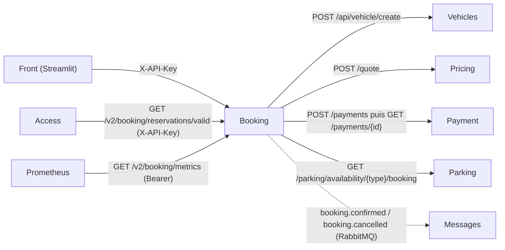
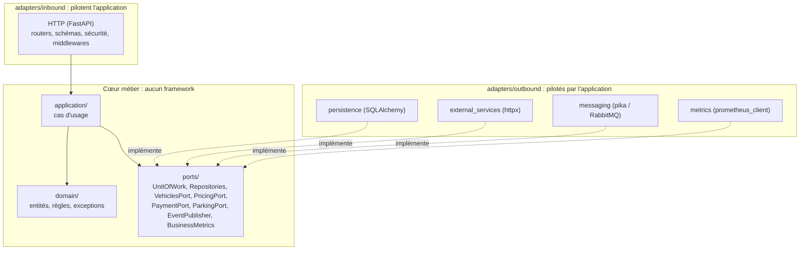
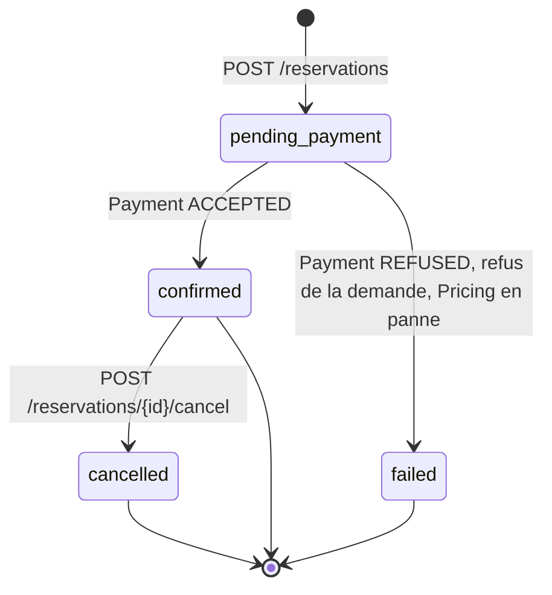
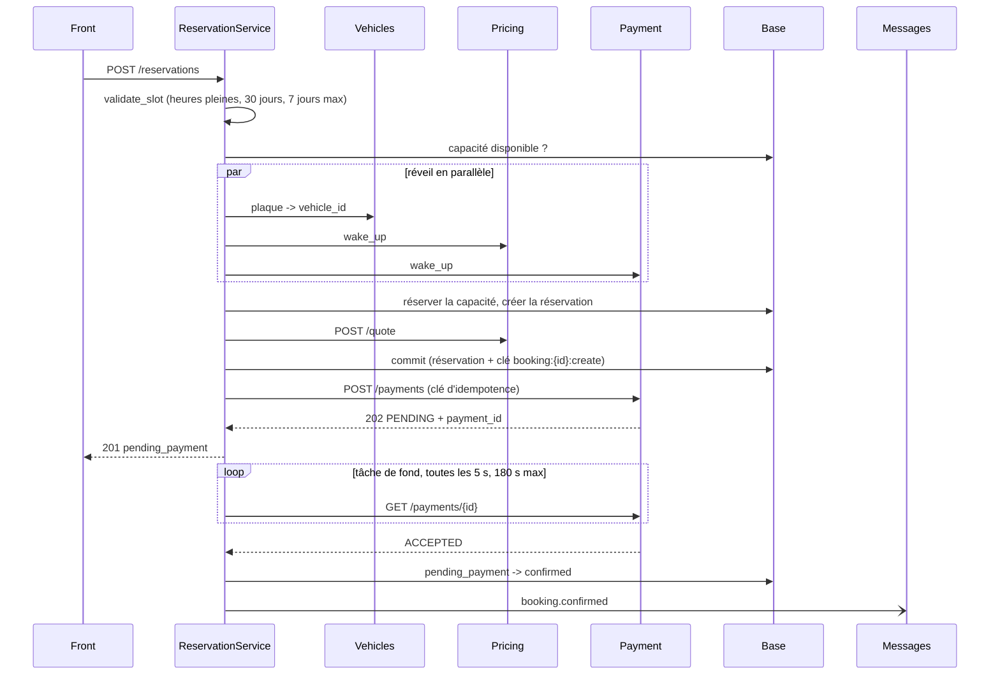

# Architecture — service Booking (v2.6.0)

Documentation technique du service **Booking**. Contexte global du projet :
[`projet_fil_rouge_parking_cadrage_metier.md`](./projet_fil_rouge_parking_cadrage_metier.md).
Scénario de test manuel : [`booking_test_scenario.md`](./booking_test_scenario.md).
Mise en route, URL et configuration : [README](../README.md).

## 1. Rôle du service

Booking gère la **disponibilité future** du parking (un calendrier de places
réservables par type de place et par heure) et le **cycle de vie d'une
réservation** : recherche de créneau, tarification, paiement anticipé,
confirmation, annulation (sans remboursement).

**Ce que Booking possède** : les réservations et le calendrier de capacité réservable.
**Ce que Booking ne possède pas** : la plaque réelle (Vehicles), les règles de
tarification (Pricing), l'encaissement (Payment), le stock physique de places
(Parking), l'ouverture de la barrière et l'attribution d'une place précise (Access).

### Place dans le système



- Vehicles, Pricing, Payment et Parking sont appelés en **HTTP synchrone** :
  c'est toujours Booking qui appelle, aucun service ne rappelle Booking.
- Payment répond d'abord `PENDING` ; Booking **interroge** ensuite
  `GET /payments/{id}` jusqu'à `ACCEPTED` ou `REFUSED` (Payment n'a pas de webhook).
- Messages est prévenu par **événement** sur le bus RabbitMQ (CloudAMQP), sans réponse attendue.
- Chaque appel porte l'en-tête `X-Correlation-ID` (voir §9.1).

---

## 2. Architecture hexagonale (ports & adapters)

Une règle est toujours vraie : **le métier ne dépend jamais d'une technologie**.
`app/domain/` et `app/application/` ignorent FastAPI, SQLAlchemy, httpx, pika et
Prometheus : ils ne connaissent que des interfaces (`app/ports/`). Les adaptateurs
(`app/adapters/`) branchent une technologie concrète sur ces interfaces.



- **`domain/`** : dataclasses et règles pures (`validate_slot`, `hour_slots`). L'heure
  courante est passée en paramètre : les règles se testent sans horloge ni base.
- **`ports/`** : interfaces (`ABC`) dont `application/` a besoin.
- **`application/`** : cas d'usage `ReservationService`, `CapacityService`,
  `ParkingSyncService`. Ils n'utilisent que les ports.
- **`adapters/inbound/http/`** : l'API REST. Traduit une requête en appel de cas
  d'usage et une exception métier en code HTTP ; porte aussi la sécurité et les middlewares.
- **`adapters/outbound/`** : SQLAlchemy, clients httpx, publication RabbitMQ, métriques Prometheus.

**Sens des dépendances** : toutes les flèches pointent vers le centre.
`domain/` et `ports/` n'importent jamais un adaptateur. C'est ce qui a permis de
passer de SQLite à Postgres, des mocks aux vrais services, et d'écrire les tests
avec de faux adaptateurs, sans toucher au métier.

---

## 3. Arborescence

```
api/V1/booking/
  app/
    __init__.py                    # __version__ : seule source de la version
    main.py                        # composition root : app FastAPI, middlewares, routes
    config.py                      # configuration (variables d'environnement / .env)
    correlation.py                 # identifiant de corrélation (ContextVar)
    logging_config.py              # logs console + fichier journalier
    metrics.py                     # déclaration des métriques Prometheus

    domain/                        # cœur métier, zéro dépendance framework
      entities.py                  # Reservation, CapacitySlot
      enums.py                     # PlaceType (+ libellés), ReservationStatus
      value_objects.py             # PriceQuote, PaymentAttempt, PaymentStatus
      exceptions.py                # DomainError et sous-classes
      rules.py                     # validate_slot, hour_slots

    ports/
      repositories.py, unit_of_work.py
      external_services.py         # VehiclesPort, PricingPort, PaymentPort
      parking.py                   # ParkingPort
      event_publisher.py           # EventPublisher
      metrics.py                   # BusinessMetrics, Operation, Result

    application/
      reservation_service.py       # création, suivi du paiement, annulation, vérification Access
      capacity_service.py          # disponibilité, réservation / libération de capacité
      parking_sync_service.py      # capacité réservable lue chez Parking

    adapters/
      inbound/http/
        security.py                # clé d'API (X-API-Key, Bearer pour /metrics)
        correlation_middleware.py  # X-Correlation-ID
        metrics_middleware.py      # http_requests_total, http_request_duration_seconds
        security_headers_middleware.py
        exception_handlers.py      # exceptions métier -> codes HTTP, 500 générique
        dependencies.py            # câblage des cas d'usage et suivi du paiement en tâche de fond
        schemas.py                 # DTO Pydantic (validation des entrées)
        routers/                   # health, availability, reservations, capacity, parking_sync
      outbound/
        persistence/               # database, orm_models, repositories, unit_of_work, migrations
        external_services/         # vehicles, pricing, payment, parking, http_client, wake_up
        messaging/event_publishers.py
        metrics/prometheus_metrics.py

  tests/                           # 112 tests pytest (voir §10)
  mocks/server.py                  # faux Vehicles / Pricing / Payment pour le local
  scripts/seed_capacity.py         # capacité de test sans Parking
  requirements.txt, requirements-dev.txt, pytest.ini, Dockerfile, .env.example

front/app.py                       # interface Streamlit
monitoring/                        # Prometheus + Grafana (docker compose)
.github/workflows/ci.yml           # intégration continue
```

---

## 4. Modèle de données

Le domaine (`domain/entities.py`, dataclasses) et la persistance
(`orm_models.py`, SQLAlchemy) ont chacun leur représentation ; `repositories.py`
convertit dans les deux sens. Aucun cas d'usage ne manipule un objet ORM.

### `Reservation`

| Champ | Type | Notes |
|---|---|---|
| `id` | `str(6)` | Code à 6 chiffres, tiré avec `secrets` (il permet de consulter et d'annuler) ; jamais réattribué. |
| `vehicle_id` | `str` | Identifiant pseudonymisé renvoyé par Vehicles, **jamais la plaque**. |
| `email` | `str` | Transmis à Messages pour la confirmation. |
| `place_type` | `PlaceType` | `STANDARD`, `HANDICAPPED`, `ELECTRIC`, `XL`, `TWO_WHEELS` : codes communs à tous les services. |
| `start_at` / `end_at` | `datetime` | UTC sans fuseau, heures pleines ; `end_at` exclu. |
| `status` | `ReservationStatus` | Voir cycle de vie. |
| `price_amount`, `price_reference` | `Decimal`, `str` | Montant et `quote_id` renvoyés par Pricing. |
| `payment_id` | `str` | Identifiant du paiement chez Payment. |
| `payment_idempotency_key` | `str` | `booking:{id}:create`, fixée à la création, réutilisée à chaque nouvel essai. |
| `correlation_id` | `str` | Identifiant de la requête de création, réutilisé à chaque étape ultérieure. |

### `CapacitySlot`

Un compteur par type de place et par heure pleine (`allocated`, `booked`,
`free = allocated - booked`). **Pas d'affectation d'une place précise** : Booking
gère un stock réservable, Access attribue la place à l'entrée.

### Cycle de vie



- Chaque transition passe par `transition_status(id, depuis, vers)` : une mise à
  jour **conditionnelle** en une requête. Deux traitements concurrents (tâche de
  fond et consultation par le client) ne peuvent pas appliquer deux fois la même
  transition : un seul publie l'événement, la place n'est libérée qu'une fois.
- `failed` et `cancelled` libèrent la capacité. Une réservation n'est jamais
  supprimée : son code reste pris, la clé d'idempotence reste unique.

### Schéma de la base

Pas d'Alembic : `Base.metadata.create_all` crée les tables, et
`persistence/migrations.py` ajoute au démarrage les colonnes apparues après coup
(`correlation_id`, `payment_idempotency_key`). En ligne, la base est un
**Postgres** (`DATABASE_URL`) : le disque Render est effacé à chaque redémarrage.

---

## 5. Ports et adaptateurs

| Port | Rôle | Implémentation |
|---|---|---|
| `ReservationRepository`, `CapacityRepository`, `UnitOfWork` | Persistance et transaction | `SqlAlchemy*` |
| `VehiclesPort` | Plaque → identifiant pseudonymisé | `HttpVehiclesClient` (`POST /api/vehicle/create`) |
| `PricingPort` | Prix d'un créneau | `HttpPricingClient` (`POST /quote`, mode `reserved`) |
| `PaymentPort` | Demande et statut de paiement | `HttpPaymentClient` (`POST /payments`, `GET /payments/{id}`, montants en centimes) |
| `ParkingPort` | Places réservables par type | `HttpParkingClient` (`GET /parking/availability/{type}/booking`) |
| `EventPublisher` | Événements vers Messages | `RabbitMQEventPublisher`, ou `LoggingEventPublisher` sans `CLOUDAMQP_URL` |
| `BusinessMetrics` | Compter les opérations métier | `PrometheusBusinessMetrics` (`NoOpBusinessMetrics` par défaut) |

**Câblage** : `adapters/inbound/http/dependencies.py` est le seul fichier qui
connaît à la fois un port et son implémentation. À chaque requête, il ouvre un
`SqlAlchemyUnitOfWork` et assemble les cas d'usage. Les tests remplacent ce
câblage par de faux adaptateurs (`tests/fakes.py`).

**Réveil des services Render** : sur le plan gratuit, un service en veille met
30 à 60 s à répondre. Pendant l'appel à Vehicles, Booking réveille Pricing et
Payment en parallèle (`wake_up`) ; le délai des appels sortants est de 120 s.

**Erreurs** : le domaine lève des exceptions pures, traduites en un seul endroit
(`exception_handlers.py`) :

| Exception | Code |
|---|---|
| `InvalidSlotError` | 422 |
| `CapacityUnavailableError`, `CapacityBelowBookedError`, `InvalidReservationStateError` | 409 |
| `ReservationNotFoundError` | 404 |
| `ExternalServiceError` | 502 |
| `ReservationIdGenerationError` | 500 |
| Toute autre exception | 500 générique `{"detail", "correlation_id"}`, détail seulement dans les logs |

---

## 6. API

Documentation interactive sur `/docs`. Toutes les routes sont sous `/v2/booking`
et exigent la clé d'API, sauf `/health`.

| Méthode | Route | Rôle | Appelée par |
|---|---|---|---|
| `GET` | `/health` | Supervision et version (public) | Render, tous |
| `GET` | `/availability` | Places libres sur un créneau (lecture seule) | front |
| `POST` | `/reservations` | Créer une réservation (201, `pending_payment`) | front |
| `GET` | `/reservations/{id}` | Consulter, avec mise à jour du statut de paiement | front |
| `POST` | `/reservations/{id}/cancel` | Annuler une réservation confirmée, sans remboursement | front |
| `GET` | `/reservations/valid?vehicle_id=&at=` | Le véhicule a-t-il une réservation valable maintenant ? | **Access** |
| `GET` | `/reservations?vehicle_id=` | Historique d'un véhicule | debug |
| `PUT` | `/capacity-slots/{type}/{heure}` | Ajuster la capacité d'un créneau | tests, correction |
| `POST` | `/capacity-slots/sync` | Forcer la synchronisation avec Parking | exploitation |
| `GET` | `/metrics` | Métriques Prometheus (X-API-Key ou Bearer) | Prometheus |

`POST /cancel` plutôt que `DELETE` : l'annulation est une **action métier** qui
change un statut, la réservation n'est pas supprimée (son code reste réservé).

---

## 7. Flux métier

### 7.1. Création et paiement



- La disponibilité est vérifiée **avant** d'appeler Vehicles (réponse rapide si
  complet), puis la réservation de capacité vérifie chaque heure à nouveau.
- La réservation est **commitée avant l'appel à Payment** : si Booking s'arrête
  pendant l'appel, la réservation et sa clé existent toujours.
- Issue de `POST /payments` :
  - 202 : `payment_id` enregistré ;
  - 422 : refus certain, réservation `failed`, place libérée, 502 au client ;
  - timeout, réseau, 5xx, 401, 409 : **issue inconnue**, la réservation reste en
    attente et la demande sera renvoyée **avec la même clé** (Payment renvoie
    alors le paiement existant : jamais de double débit).
- Pricing en panne : aucun paiement demandé, réservation `failed`, place libérée, 502.
- Vehicles en panne : rien n'est réservé, 502.

### 7.2. Suivi du paiement

`sync_payment_status` applique le statut de Payment à une réservation en attente.
Il est appelé par la tâche de fond, par `GET /reservations/{id}` et par
`GET /reservations/valid`. Si la tâche de fond a été coupée (redémarrage Render),
la consultation suivante termine le travail. Idempotent grâce à `transition_status`.

### 7.3. Vérification par Access

Valable si `confirmed` et `start_at <= at < end_at` (début inclus, fin exclue, sans
tolérance). Toujours 200 : `valid` porte la réponse, avec le type de place réservé
et sans l'e-mail. Une réservation encore `pending_payment` est d'abord revérifiée
auprès de Payment : un client qui a payé n'est pas bloqué à la barrière.

### 7.4. Annulation

Seule une réservation `confirmed` est annulable (409 sinon). Passage à `cancelled`,
place libérée immédiatement, événement `booking.cancelled`. **Aucun remboursement** :
Payment ne gère pas les remboursements. Le cadrage métier (§2.7) prévoyait une
réservation non annulable : c'est une extension assumée.

### 7.5. Capacité depuis Parking

Au démarrage puis toutes les heures, `ParkingSyncService` lit pour chaque type
`spot_available` chez Parking et l'applique à chaque heure des 30 prochains jours
(+ 7 jours de durée maximale). Une heure n'est **jamais** ramenée sous le nombre de
places déjà réservées.

⚠️ **Point de friction** : Parking a confirmé que `spot_available` est le nombre de
places **libres à l'instant**, pas un quota réservé à Booking. Booking s'en sert
pourtant comme capacité de toutes les heures à venir :
- si le parking est plein maintenant, plus aucune réservation n'est possible pour
  la semaine suivante ;
- s'il est vide, Booking peut promettre toutes les places sur un créneau futur où
  des clients sans réservation seront peut-être déjà garés.

Le bon contrat serait un **quota réservable** par type, fixé par Parking
indépendamment de l'occupation. Faute de temps avant le rendu, ce point est
documenté et non corrigé ; `PUT /capacity-slots` permet d'ajuster un créneau à la main.

---

## 8. Bus d'événements (RabbitMQ / CloudAMQP)

| Événement interne | Routing key | Champ `event` |
|---|---|---|
| `reservation.confirmed` | `booking.confirmed` | `RESERVATION_CONFIRMED` |
| `reservation.cancelled` | `booking.cancelled` | `RESERVATION_CANCELLED` |

Format confirmé avec Messages. Exchange `microservice-event-bus`
(`EVENT_BUS_EXCHANGE`). Le payload contient code, `vehicle_id`, e-mail, type de
place (code et libellé), créneau, et pour la confirmation montant et `payment_id`.
L'identifiant de corrélation part dans la propriété AMQP `correlation_id` et
l'en-tête `X-Correlation-ID`.

Une panne du bus ne fait pas échouer la requête : le statut est déjà validé en
base, l'événement perdu est logué en `ERROR` pour être renvoyé à la main
(limite connue, voir §13).

---

## 9. Observabilité

### 9.1. Identifiant de corrélation

`X-Correlation-ID` est repris de l'appelant (s'il est valide : 128 caractères
alphanumériques au plus) ou généré, puis :
- écrit dans chaque ligne de log (filtre de logging) ;
- renvoyé dans la réponse ;
- transmis à Vehicles, Pricing, Payment, Parking et dans les événements RabbitMQ ;
- **stocké avec la réservation** : la confirmation, l'échec ou l'annulation, même
  déclenchés plus tard par une autre requête, portent l'identifiant du parcours d'origine.

### 9.2. Logs

Console, plus un fichier par jour dans `LOG_DIR` (14 jours). Sur Render, `LOG_DIR`
est vide : console seule, lisible dans l'onglet *Logs*. Jamais de plaque, de clé ni
de valeur reçue dans un log de validation.

### 9.3. Métriques (`GET /v2/booking/metrics`)

| Métrique | Labels | Sens |
|---|---|---|
| `http_requests_total` | `method`, `route`, `status`, `outcome` | Trafic HTTP |
| `http_request_duration_seconds` | `method`, `route` | Durée, jusqu'à l'envoi de la réponse (hors tâches de fond), seuils de 10 ms à 120 s |
| `parking_operations_total` | `service`, `operation`, `result` | Réservations, paiements, annulations, vérifications Access, synchros de capacité |

`route` est le **modèle** de route (`/reservations/{reservation_id}`), jamais l'URL
réelle : le nombre de séries reste fini. Le tableau de bord Grafana
(`monitoring/`) montre disponibilité des services, trafic, erreurs, opérations
métier et latence p50 / p95 / p99.

---

## 10. Sécurité, tests et CI

### Sécurité

| Mesure | Détail |
|---|---|
| Clé d'API unique | `API_KEY`, en-tête `X-API-Key`, sur toutes les routes sauf `/health` ; partagée avec le front et Access. `/metrics` accepte aussi `Authorization: Bearer` (format de Prometheus). |
| Comparaison | Temps constant (`hmac.compare_digest`) ; 401 sans clé ou clé fausse. |
| Échec fermé | Sans `API_KEY` configurée, tout est refusé (et signalé au démarrage). |
| Entrées | Plaque 2 à 20 caractères `[A-Za-z0-9 -]`, e-mail validé, `vehicle_id` 128 caractères, code de réservation `^\d{6}$`. |
| Erreurs | 500 générique avec `correlation_id`, détail seulement dans les logs. |
| En-têtes | `nosniff`, `X-Frame-Options: DENY`, `Referrer-Policy: no-referrer`, `Cache-Control: no-store`. |
| Secrets | Jamais dans Git (variables Render, `.env` ignoré) ; clés sortantes par service (`*_API_KEY`). |
| Conteneurs | Utilisateur non-root, image Prometheus en version fixe. |

Le choix d'**une seule clé** plutôt qu'une clé par appelant avec des droits
différents est volontaire : plus simple à distribuer, suffisant pour ne plus
exposer le service librement.

### Tests (`api/V1/booking/tests/`, 112 tests)

Base SQLite jetable, clé de test, faux Vehicles / Pricing / Payment / bus
(`tests/fakes.py`) : aucun appel réseau. Couvrent les règles de créneau, la
capacité, tout le parcours de réservation et ses pannes, les 10 cas Access, les
routes HTTP, la sécurité, le correlation ID et les métriques.

### Intégration continue (`.github/workflows/ci.yml`)

À chaque push, pull request et tag `v*` : lint `ruff`, tests `pytest`, SAST
`bandit`, SCA `pip-audit`, recherche de secrets `gitleaks` sur tout l'historique,
puis build des deux images Docker et démarrage de l'API sur `/health`. Sur un tag,
la CI vérifie qu'il correspond à `app.__version__`. Render ne déploie qu'un commit
dont la CI est verte (*After CI Checks Pass*).

---

## 11. Configuration

Lue par `app/config.py` (`pydantic-settings`) depuis l'environnement ou `.env`
(modèle : `.env.example`). Liste complète dans le README ; les principales :

| Variable | Rôle |
|---|---|
| `DATABASE_URL` | SQLite en local, Postgres en ligne (URL collée telle quelle, forcée sur psycopg 3). |
| `API_KEY` | Clé entrante de Booking. |
| `VEHICLES_SERVICE_URL`, `PRICING_SERVICE_URL`, `PAYMENT_SERVICE_URL`, `PARKING_SERVICE_URL` | Services appelés (mocks locaux par défaut ; Parking vide = pas de synchro). |
| `VEHICLES_API_KEY`, `PRICING_API_KEY`, `PAYMENT_API_KEY`, `PARKING_API_KEY` | Clés sortantes. |
| `CLOUDAMQP_URL`, `EVENT_BUS_EXCHANGE` | Bus d'événements (vide = simple log). |
| `PAYMENT_POLL_INTERVAL_SECONDS`, `PAYMENT_POLL_TIMEOUT_SECONDS` | Suivi du paiement (5 s, 180 s). |
| `HTTP_TIMEOUT_SECONDS` | 120 s, pour les réveils Render. |
| `RESERVATION_HORIZON_DAYS`, `RESERVATION_MAX_DURATION_HOURS` | 30 jours, 168 h. |
| `LOG_LEVEL`, `LOG_DIR`, `LOG_RETENTION_DAYS` | Logs. |

⚠️ En PowerShell, `$env:VAR = ""` ne transmet pas une variable vide au processus :
`pydantic-settings` reprend alors la valeur du `.env`. Pour couper le bus en local,
vider la ligne dans `.env`.

---

## 12. Mocks, front et extension

**Mocks** (`mocks/server.py`, port 9000, hors de l'hexagone) : mêmes contrats que
les vrais services. Vehicles renvoie un code, Pricing un tarif simple, Payment
répond `PENDING` puis `ACCEPTED` après quelques secondes ;
`POST /payment/payments/{id}/force-status` force `REFUSED` pour les tests.

**Front** (`front/app.py`) : client Streamlit en heure de Paris (disponibilité,
réservation, suivi du paiement, annulation par code). Il envoie la clé
(`BOOKING_API_KEY`) côté serveur : elle n'arrive jamais dans le navigateur.

| Je veux... | Je touche... |
|---|---|
| Changer une règle de créneau | `domain/rules.py` (+ `tests/test_rules.py`) |
| Ajouter un champ à une réservation | `entities.py`, `orm_models.py`, `repositories.py`, `migrations.py`, `schemas.py` |
| Ajouter un cas d'usage | une méthode dans `application/`, une route dans `routers/` |
| Brancher un nouveau service externe | un port dans `ports/`, un adaptateur dans `outbound/external_services/`, le câblage dans `dependencies.py`, un faux dans `tests/fakes.py` |
| Changer de base ou de broker | `DATABASE_URL`, ou une classe implémentant `EventPublisher` |
| Sortir une nouvelle version | `app/__init__.py` puis tag `vX.Y.Z` |

---

## 13. Limites connues

- **Capacité depuis Parking** : `spot_available` est un stock libre à l'instant,
  utilisé comme quota futur (voir §7.5).
- **Événements perdus** si le bus est en panne : logués, à renvoyer à la main.
  Correction prévue : un *outbox* (événements stockés en base et renvoyés en tâche de fond).
- **Concurrence** : pas de verrou `SELECT ... FOR UPDATE` sur la capacité ; les
  transitions de statut sont protégées, la réservation de capacité simultanée
  sur la dernière place reste théoriquement possible sous forte charge.
- **Pas d'Alembic** : migrations minimales au démarrage.
- **Annulation sans remboursement**, extension par rapport au cadrage (non annulable).
- **Pas de limite de débit** sur `POST /reservations`.
